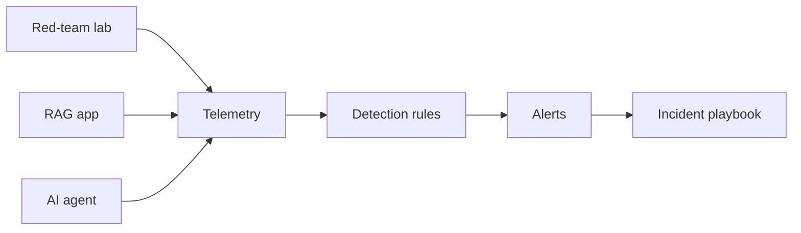

# AI Security Monitoring & Detection

Detection and response for AI systems — the half of AI security most portfolios
skip. Prevention fails eventually; this project ships the telemetry, detections and
incident playbook that catch misuse across the systems in projects 1–3.

## Headline result

Deterministic run (`python -m app.run_detections`):

| Metric | Value |
| --- | --- |
| Sessions | 17 (5 attack, 12 benign) |
| Attack sessions detected | **5 / 5** |
| False positives on benign | **0** |

See the generated [DETECTIONS.md](DETECTIONS.md).

## What it does



`app/events.py` generates a realistic, labelled telemetry stream (prompts,
responses, retrievals, tool calls, identity events, blocked actions) mixing benign
and attack sessions. `detections/rules.py` runs over it with no access to the
labels; `app/run_detections.py` scores the rules against the labels.

## Detections

| Rule | Signal | Severity |
| --- | --- | --- |
| `repeated-injection` | ≥3 injection/jailbreak prompts in one session | high |
| `secret-in-prompt` | a credential-shaped string submitted in a prompt (shadow-AI leak) | high |
| `anomalous-retrieval` | a single retrieval pulling an abnormal number of chunks (scraping) | medium |
| `denied-tool-call` | an agent tool call blocked by the authorization gateway | high |
| `exfil-in-output` | a confidential canary present in model output | critical |

The thresholds (injection count, retrieval volume) are the tuning craft — set to
catch every attack session here with zero benign false positives.

## Incident response

[docs/INCIDENT_PLAYBOOK.md](docs/INCIDENT_PLAYBOOK.md) walks one alert end to end:
validate → preserve evidence → contain/revoke → assess exposure → communicate.

## Run it

```sh
python -m app.run_detections          # generate telemetry, detect, score, write report
python -m unittest discover -s tests  # rule tests
```

## Portfolio checklist

- [x] Labelled synthetic telemetry across the three upstream systems
- [x] Five detection rules with ground-truth scoring (coverage + false positives)
- [x] Incident playbook for one scenario, end to end
- [x] OWASP / MITRE ATLAS mapping, CI that runs the rules on change
